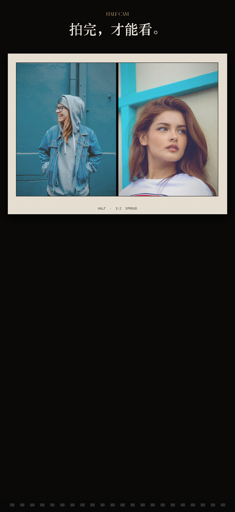
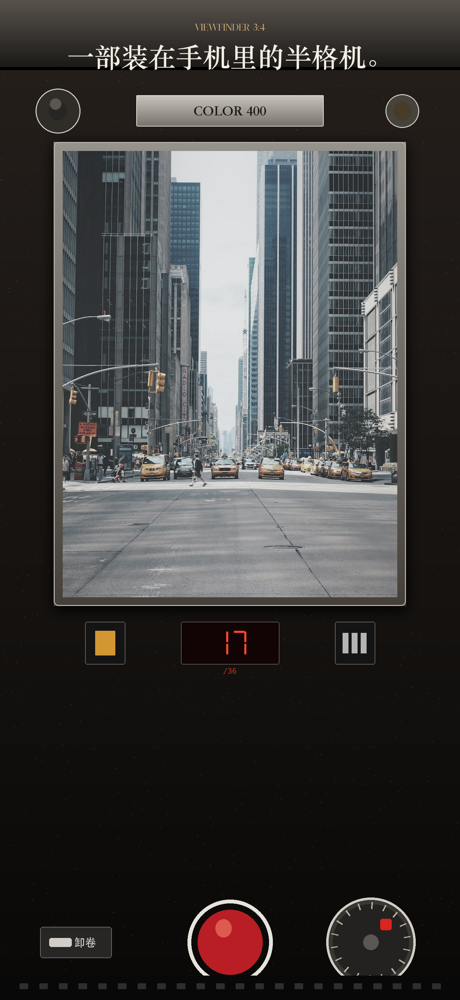
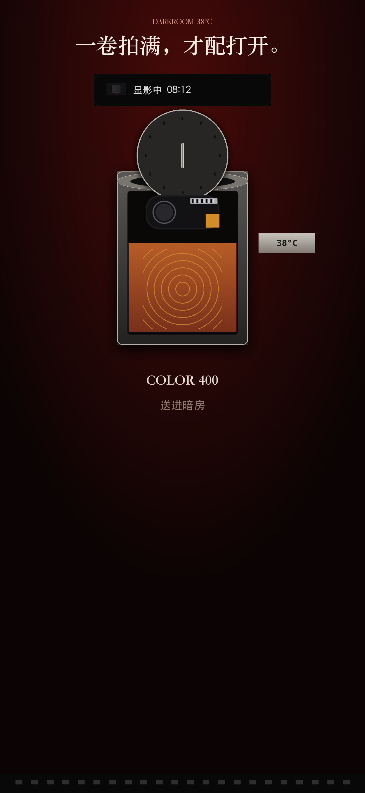

<a id="zh"></a>

# HALF CAM

<p>
  
</p>

**简体中文** · [English](#english)

装在 iPhone 里的半格胶片机。不是滤镜包，不是美颜相机。

> 拍完才能看。一卷拍满，才配打开。

<p>
  
  
  
</p>

## 规矩

- 没上卷，快门是死的
- 拍完没有预览，格子是黑的
- 装卷时选定胶片，洗完不能改
- 相邻两格，自动成一对页

## 机身

3:4 半格取景。皮革机身，实体滚轮，计数窗。光学预览默认不加颜色，和真胶片取景器一样。

拍满、倒片、送洗。药液、负片、揭晓。可等，可加急。杀进程也不丢卷。

单格导出 3:4。对页导出 3:2，中间留黑缝。只有你点导出，才会进系统相册。

显影走 [SpektraLab](https://github.com/JamesQiu2005/SpektraLab) 光谱引擎。胶片与相纸光谱数据来自 [spektrafilm](https://github.com/andreavolpato/spektrafilm)。

免费即可拍完一卷。年卡 / 买断：更多卷、更长卷、每月加急。

## 要求

- iOS 17 或更高
- Xcode 15 或更高
- iPhone。竖屏锁定

## 构建

```sh
git clone https://github.com/xuyue1998/halfcam.git
open HalfCam.xcodeproj
```

选 `HalfCam` scheme，真机或模拟器运行。工程已打开 `SPEKTRA_ENGINE=1`。

若需重编光谱引擎：

```sh
./scripts/fetch-spektralab.sh
./scripts/build-spektra-ios.sh
```

接入说明见 [`SPEKTRA.md`](SPEKTRA.md)。

## 许可证

HALF CAM 以 [GNU GPL-3.0-or-later](LICENSE) 发布，不含担保。

- SpektraLab 引擎：GPL-3.0-or-later，Hanze Qiu / JamesQiu2005
- 胶片过程模型、测量配置、印片 LUT：CC BY-SA 4.0，Andrea Volpato / spektrafilm

详见 [`NOTICE.md`](NOTICE.md)、[`LICENSE-SPEKTRAFILM.txt`](LICENSE-SPEKTRAFILM.txt)。

对应源码：<https://github.com/xuyue1998/halfcam>

## 法律

- [法律信息](https://xuyue1998.github.io/halfcam/legal.html)
- [隐私政策](https://xuyue1998.github.io/halfcam/privacy.html)

HALF CAM 是独立 App，与任何胶片或相机品牌无关。商店物料与本仓库不使用第三方商标作为卖点。

---

<a id="english"></a>

# HALF CAM

**English** · [简体中文](#zh)

A half-frame film camera in your iPhone. Not a filter pack. Not a beauty cam.

> You don’t see the photo until it’s developed.

## The rules

- The shutter is dead until you wind
- No preview. Shot frames stay black
- The look is locked when you load the roll
- Two adjacent frames become one spread

## The body

A 3:4 half-frame finder. Leather. A real winder. A frame counter. The finder stays optical by default — like film, not like a beauty cam.

Finish the roll, rewind, send it in. Chemistry, negatives, then the reveal. Wait it out or rush it. Kill the app — the roll is still there.

Export singles in 3:4. Spreads in 3:2 with a black gutter. Nothing hits Photos until you export.

Development uses the [SpektraLab](https://github.com/JamesQiu2005/SpektraLab) spectral engine. Film and paper spectral data come from [spektrafilm](https://github.com/andreavolpato/spektrafilm).

Shoot a full roll for free. Yearly or lifetime: more rolls, longer rolls, monthly rush develops.

## Requirements

- iOS 17 or later
- Xcode 15 or later
- iPhone. Portrait locked

## Build

```sh
git clone https://github.com/xuyue1998/halfcam.git
open HalfCam.xcodeproj
```

Select the `HalfCam` scheme and run on a device or simulator. `SPEKTRA_ENGINE=1` is already on.

To rebuild the spectral engine:

```sh
./scripts/fetch-spektralab.sh
./scripts/build-spektra-ios.sh
```

See [`SPEKTRA.md`](SPEKTRA.md) for the integration notes.

## Licence

HALF CAM is released under [GNU GPL-3.0-or-later](LICENSE), without warranty.

- SpektraLab engine: GPL-3.0-or-later, Hanze Qiu / JamesQiu2005
- Film process model, measured profiles, print LUTs: CC BY-SA 4.0, Andrea Volpato / spektrafilm

See [`NOTICE.md`](NOTICE.md) and [`LICENSE-SPEKTRAFILM.txt`](LICENSE-SPEKTRAFILM.txt).

Corresponding source: <https://github.com/xuyue1998/halfcam>

## Legal

- [Legal notices](https://xuyue1998.github.io/halfcam/legal.html)
- [Privacy Policy](https://xuyue1998.github.io/halfcam/privacy.html)

HALF CAM is independent. Not affiliated with any film or camera brand. Store materials and this repository do not use third-party marks as selling points.
