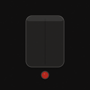

<a id="zh"></a>

# HALF CAM

<p>
  
</p>

**简体中文** · [English](#english)

装在 iPhone 里的半格胶片机。装卷、过片、拍摄，把揭晓留给暗房。

> 拍满一卷，再见照片。相邻两格，拼成日常的一页。

[项目主页](https://xuyue1998.github.io/halfcam/) · [源代码](https://github.com/xuyue1998/halfcam) · [隐私政策](https://xuyue1998.github.io/halfcam/privacy.html)

## 拍一卷的过程

1. **装卷**：选定胶片、格数、颗粒、相纸等设置，装入机身。
2. **过片**：转动过片轮，上卷后再按快门；每拍一格，都要再次过片。
3. **拍摄**：显影前不提供照片回看，取景预览默认不叠加胶片色彩。
4. **倒片与显影**：拍满后倒片，送入暗房，等待取件，再揭晓负片与成片。
5. **保存**：相邻两格组成对页，也可单格导出到系统相册。

首次使用提供 **2 格体验卷**，体验卷等待约 5 秒。普通胶卷的等待时间随格数变化；加急券可以跳过等待，但不跳过实际图像处理。

严格模式默认开启：拍过的胶卷需要拍满才能卸下。关闭严格模式后可提前卸卷，未拍的格数作废。

## 功能

| 模块 | 当前功能 |
|---|---|
| 相机 | 3:4 半格取景、拟物机身、过片轮、倒片旋钮、计数窗、声音与触感 |
| 拍摄控制 | A / M 模式、ISO、快门、对焦、曝光调节；镜头与 ProRAW 等能力依设备而定 |
| 胶片 | 彩色、反转、电影、黑白；装卷时选择风格及可用参数，显影后不可更换 |
| 暗房 | 显影等待、负片与成片揭晓、加急券、取件通知及实时活动 |
| 相册 | 按胶卷浏览、对页与单格导出、可选片边、自动导出、删除本机胶卷 |
| 语言 | 简体中文、繁體中文、English、日本語、한국어，可跟随系统 |

通知、实时活动以及部分相机能力需要系统支持，并受设备和权限设置影响。

### 照片与数据

- **自动导出默认开启**，可在设置中关闭。体验卷不自动导出；保存到系统相册需要授权。
- 关闭自动导出后，可在 App 内相册中手动导出单格、对页或整卷。
- 不带片边时，单格为 **3:4**，对页约为 **3:2**，中间保留黑缝；添加片边后，整体比例会变化。
- 胶卷与照片保存在本机，关闭 App 后仍保留。App 不提供胶片照片的云备份；加急券余量的 iCloud 同步不等于照片备份。
- **删除 App 会删除其中的全部胶片与照片。** 已导出到系统相册的副本不受影响，请提前保存想保留的照片。

## 免费与会员

| 权益 | 免费 | 年卡 | 买断 |
|---|---|---|---|
| 每月可装卷数 | 3 卷 | 9 卷 | 不限 |
| 可选格数 | 12 | 12 / 24 / 36 | 12 / 24 / 36 / 54 / 72 |
| 每月赠加急券 | 1 张 | 3 张 | 6 张 |
| 付费方式 | 免费使用 | 按年自动续订 | 一次性购买 |

- 三档都保留显影等待；每张加急券可跳过一卷的等待。
- 每月赠券于次月初失效，购买的加急券不过期；开启 iCloud 后可同步购买券余量。
- 实际价格以 App 内商店显示为准，支持恢复购买。

## 光谱显影

显影使用 [SpektraLab](https://github.com/JamesQiu2005/SpektraLab) 光谱引擎，胶片与相纸光谱数据来自 [spektrafilm](https://github.com/andreavolpato/spektrafilm)。

Swift 通过 C ABI 接入引擎。工程已启用 `SPEKTRA_ENGINE=1`；引擎处理失败时不使用 LUT 替代。接入与重编说明见 [`SPEKTRA.md`](SPEKTRA.md)。

## 开发与构建

### 环境

- iPhone，iOS 17 或更高，竖屏使用。
- macOS 与完整安装的 Xcode，包含 iOS 17 或更新的 SDK。
- 当前引擎构建脚本生成真机及模拟器的 **arm64** 库；模拟器开发建议使用 Apple Silicon Mac。
- 真机拍摄、镜头切换、ProRAW、触感与购买流程应在相应设备和测试环境中验证。

### 打开工程

```sh
git clone https://github.com/xuyue1998/halfcam.git
cd halfcam
open HalfCam.xcodeproj
```

在 Xcode 中选择 `HalfCam` scheme 和目标设备。真机运行时，将 App 与 `DevelopLive` 扩展的签名团队改为自己的开发团队，并按需配置 Bundle ID、iCloud 与内购。

本地 StoreKit 测试配置位于 [`HalfCam.storekit`](HalfCam.storekit)，可在 scheme 的运行选项中选用；该配置不会自动更新 App Store Connect。

### 重编光谱引擎

如缺少引擎产物或需要更新本地构建：

```sh
./scripts/fetch-spektralab.sh
./scripts/build-spektra-ios.sh
```

脚本默认使用 `/Applications/Xcode.app/Contents/Developer`；Xcode 位于其他路径时，可通过 `DEVELOPER_DIR` 指定。

当前模拟器库仅含 arm64。在 Apple Silicon Mac 上，如果命令行构建报缺少 x86_64 符号，可明确指定 arm64；同时确认 `DEVELOPER_DIR` 指向完整的 Xcode，而不是 Command Line Tools：

```sh
xcodebuild \
  -project HalfCam.xcodeproj \
  -scheme HalfCam \
  -configuration Debug \
  -destination 'generic/platform=iOS Simulator' \
  ARCHS=arm64 ONLY_ACTIVE_ARCH=YES CODE_SIGNING_ALLOWED=NO \
  build
```

### 文案校验

```sh
python3 scripts/check_copy.py
python3 scripts/check_copy.py --inventory
python3 -m doctest scripts/check_copy.py
python3 -m unittest discover -s scripts -p test_check_copy.py
```

五语言术语、权限说明与维护规范见 [`docs/COPY.md`](docs/COPY.md)。文案检查不替代 Xcode 构建和真机测试。

## 项目结构

```text
HalfCam/
├── Camera/       # 相机、取景、装卷与机械交互
├── Film/         # 胶片目录、图像处理与光谱引擎桥接
├── Develop/      # 暗房、取件通知与实时活动管理
├── Album/        # 暗盒、相册、导出与设置
├── Store/        # StoreKit 权益与会员页面
├── Feel/         # 声音与触感
└── Theme/        # 机身材质与视觉样式
DevelopLive/      # 锁屏与灵动岛实时活动扩展
vendor/           # 光谱引擎与依赖
scripts/          # 引擎构建、文案校验与商店物料脚本
docs/             # 项目网站、文案规范、法律页与商店资料
```

## 许可证

HALF CAM 以 [GNU GPL-3.0-or-later](LICENSE) 发布，不含担保。

- SpektraLab 引擎：GPL-3.0-or-later，Hanze Qiu / JamesQiu2005
- 胶片过程模型、测量配置、印片 LUT：CC BY-SA 4.0，Andrea Volpato / spektrafilm

详见 [`NOTICE.md`](NOTICE.md)、[`LICENSE-SPEKTRAFILM.txt`](LICENSE-SPEKTRAFILM.txt)。

对应源码：<https://github.com/xuyue1998/halfcam>

## 法律

- [法律信息](https://xuyue1998.github.io/halfcam/legal.html)
- [隐私政策](https://xuyue1998.github.io/halfcam/privacy.html)

HALF CAM 是独立 App，与任何胶片或相机品牌无关。商店物料与本仓库不使用第三方商标作为卖点。

---

<a id="english"></a>

# HALF CAM

**English** · [简体中文](#zh)

A half-frame film camera in your iPhone. Load, advance, and shoot. Leave the reveal to the darkroom.

> Finish the roll. Then see what you caught. Two frames, one little story.

[Website](https://xuyue1998.github.io/halfcam/) · [Source](https://github.com/xuyue1998/halfcam) · [Privacy](https://xuyue1998.github.io/halfcam/privacy.html)

## How a roll works

1. **Load**: choose your film, frame count, grain, paper, and available settings.
2. **Advance**: turn the winder before pressing the shutter, and again between frames.
3. **Shoot**: captured photos stay hidden until development. The finder does not apply film color by default.
4. **Rewind and develop**: finish the roll, rewind, and send it to the darkroom. Wait to collect it, then reveal the negatives and prints.
5. **Save**: adjacent frames become a spread. You can also export individual frames to Photos.

The first-run experience uses a **2-frame tutorial roll** with an approximately 5-second wait. Regular waits depend on roll length. Rush tickets skip the wait, not the actual image processing.

Strict mode is on by default: once a roll has been used, finish it before unloading. Turn strict mode off to unload early; unused frames are discarded.

## Features

| Area | Current features |
|---|---|
| Camera | 3:4 finder, tactile-looking body, advance wheel, rewind knob, counter, sound and haptics |
| Controls | A / M modes, ISO, shutter, focus and exposure adjustment; lenses and ProRAW depend on hardware |
| Film | Color, slide, cine and black-and-white; choose the look and available settings when loading |
| Darkroom | Development waits, negative and print reveals, rush tickets, collection notifications and Live Activities |
| Album | Browse by roll, export spreads or frames, optional film borders, auto-export and local roll deletion |
| Languages | Simplified Chinese, Traditional Chinese, English, Japanese and Korean, with a system-language option |

Notifications, Live Activities and some camera capabilities depend on system support, hardware and permissions.

### Photos and storage

- **Auto-export is on by default** and can be disabled in Settings. Tutorial rolls are not auto-exported. Saving to Photos requires permission.
- With auto-export off, manually export a frame, spread or roll from the in-app album.
- Without film borders, single frames are **3:4** and spreads are approximately **3:2**, separated by a black gutter. Borders change the overall aspect ratio.
- Film and photos remain on your device when the app closes. The app does not provide cloud backup for photos; iCloud synchronization of rush-ticket balances is not a photo backup.
- **Deleting HALF CAM removes all film and photos stored inside the app.** Copies already exported to Photos are unaffected. Save the photos you want to keep first.

## Free and membership

| Benefit | Free | Yearly | Lifetime |
|---|---|---|---|
| Rolls per month | 3 | 9 | Unlimited |
| Available frame counts | 12 | 12 / 24 / 36 | 12 / 24 / 36 / 54 / 72 |
| Monthly rush tickets | 1 | 3 | 6 |
| Payment | Free to use | Auto-renewing yearly subscription | One-time purchase |

- Every tier retains the development wait. One rush ticket skips the wait for one roll.
- Monthly tickets expire at the start of the next month. Purchased tickets do not expire; their balance can sync when iCloud is enabled.
- Prices are shown in the in-app store. Restore purchases is supported.

## Spectral development

Development uses [SpektraLab](https://github.com/JamesQiu2005/SpektraLab), with film and paper spectral data from [spektrafilm](https://github.com/andreavolpato/spektrafilm).

The Swift bridge calls the engine through its C ABI. `SPEKTRA_ENGINE=1` is enabled in the project. Failed engine processing does not fall back to a LUT. See [`SPEKTRA.md`](SPEKTRA.md) for integration details.

## Development and building

### Requirements

- An iPhone running iOS 17 or later. Portrait orientation.
- macOS and a full Xcode installation with an iOS 17 or newer SDK.
- The current engine script builds **arm64** libraries for devices and simulators. An Apple Silicon Mac is recommended for simulator development.
- Validate camera capture, lens switching, ProRAW, haptics and purchases on the appropriate hardware and test environments.

### Open the project

```sh
git clone https://github.com/xuyue1998/halfcam.git
cd halfcam
open HalfCam.xcodeproj
```

Select the `HalfCam` scheme and a destination. For device builds, use your own signing team for both the app and the `DevelopLive` extension. Configure Bundle IDs, iCloud and in-app purchases as needed.

[`HalfCam.storekit`](HalfCam.storekit) provides local StoreKit test data and can be selected in the scheme's Run options. It does not update App Store Connect.

### Rebuild the engine

If engine artifacts are missing or need rebuilding:

```sh
./scripts/fetch-spektralab.sh
./scripts/build-spektra-ios.sh
```

The script defaults to `/Applications/Xcode.app/Contents/Developer`. Set `DEVELOPER_DIR` if Xcode is installed elsewhere.

The current simulator library contains arm64 only. On an Apple Silicon Mac, explicitly select arm64 if a command-line build reports missing x86_64 symbols. Ensure `DEVELOPER_DIR` points to a full Xcode installation, not Command Line Tools:

```sh
xcodebuild \
  -project HalfCam.xcodeproj \
  -scheme HalfCam \
  -configuration Debug \
  -destination 'generic/platform=iOS Simulator' \
  ARCHS=arm64 ONLY_ACTIVE_ARCH=YES CODE_SIGNING_ALLOWED=NO \
  build
```

### Copy checks

```sh
python3 scripts/check_copy.py
python3 scripts/check_copy.py --inventory
python3 -m doctest scripts/check_copy.py
python3 -m unittest discover -s scripts -p test_check_copy.py
```

See [`docs/COPY.md`](docs/COPY.md) for terminology and maintenance guidance. These checks do not replace Xcode builds or device testing.

### Code map

- `HalfCam/Camera/`: capture, finder, loading and mechanical controls.
- `HalfCam/Film/`: film catalog, image processing and the spectral-engine bridge.
- `HalfCam/Develop/`: darkroom, collection notifications and Live Activity management.
- `HalfCam/Album/`: darkbox, album, export and settings.
- `HalfCam/Store/`: StoreKit entitlements and membership UI.
- `HalfCam/Feel/` and `HalfCam/Theme/`: sound, haptics, materials and visual styling.
- `DevelopLive/`: Lock Screen and Dynamic Island extension.
- `vendor/`, `scripts/`, `docs/`: dependencies, tooling, website and project documentation.

## Licence

HALF CAM is released under [GNU GPL-3.0-or-later](LICENSE), without warranty.

- SpektraLab engine: GPL-3.0-or-later, Hanze Qiu / JamesQiu2005
- Film process model, measured profiles, print LUTs: CC BY-SA 4.0, Andrea Volpato / spektrafilm

See [`NOTICE.md`](NOTICE.md) and [`LICENSE-SPEKTRAFILM.txt`](LICENSE-SPEKTRAFILM.txt).

Corresponding source: <https://github.com/xuyue1998/halfcam>

## Legal

- [Legal notices](https://xuyue1998.github.io/halfcam/legal.html)
- [Privacy Policy](https://xuyue1998.github.io/halfcam/privacy.html)

HALF CAM is independent. Not affiliated with any film or camera brand. Store materials and this repository do not use third-party marks as selling points.
